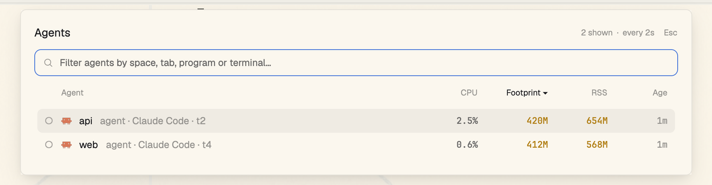

# herdr-top

A popup like the app's picker that lists every agent in this window with what its whole process tree costs: CPU, physical memory footprint, resident memory and age. Type to narrow it, click a column to sort, and pick a row to jump to that agent's terminal. The numbers come from `herdr-top`, a small Go program; the popup refreshes on its own every couple of seconds.

## What you see

- **Popup**: opens at the top of the window, 40px down, 900px wide and up to 80% of the window tall, on the theme's `popover` color, 18px padding, 10px gaps, 13px text.
- **Title row**: "Agents" (15px, semibold, `foreground`), then on the right, 11px `dim`: "N shown  ·  every 2s" ("refreshing…" while a collection runs) and "Esc".
- **Filter field**: 36px tall, 9px corners, 1px `accent` border on the `background` color; a 15px search icon, then the input (12.8px) with the placeholder "Filter agents by space, tab, program or terminal…". It has focus when the popup opens.
- **Header row**: 24px, 11px `dim`: "Agent" fills the left; right-aligned columns CPU (70px), Footprint (84px), RSS (70px), Age (70px). The sorted column is `foreground` with `▾` (descending) or `▴`.
- **Agent rows**: 32px, 7px corners, 10px gaps, left to right:
  - a 12px status glyph: a spinning spinner in `working` color, `●` in `blocked` or `done` color, `○` for idle;
  - the program's 14px icon (tinted to `foreground` when the icon is a tintable SVG);
  - the space name (`foreground`, semibold for the focused agent);
  - "tab · program · terminal address" (`dim`, truncated, takes the rest);
  - "needs you" (11px, `blocked`) for a blocked agent, "finished" (11px, `done`) for a done one;
  - the four numbers in the app's mono font (`settings().font_family`, else JetBrains Mono), 12px, right-aligned. CPU is `muted` below 25%, `working` from 25%, `blocked` from 75%. Footprint and RSS use the same three colors at 256 MiB and 1 GiB. Age is always `dim`.
- **Formats**: CPU `12.3%`; bytes in powers of 1024 as `512K`, `340M`, `1.4G`; age `<1m`, `42m`, `3h 05m`, `2d 4h`. An unavailable value shows `—` in `dim`.
- **List**: scrolls past 480px (that height is 15 rows; it is `6 + rows × 32` px when shorter). The row under the cursor, and the selected row, get the `hover` background.
- **Footer line** (11px, one line, only when there is something to say), first that applies: a collection error (`blocked`); the selected row's diagnostics joined by `; ` (`working`); "collecting…" before the first result; "no agent matches" or "no agents in this window" (`dim`).

## How it behaves

- Typing filters at once and moves the selection to the first row. It matches, case-insensitively, against the space, tab, program name, agent kind, terminal address and title.
- Click a column header: sort by it, descending. Click it again to flip. The default is Footprint, descending. Descending puts the biggest first and age oldest first, with unavailable values last; ties fall back to the terminal address so rows don't swap places on every refresh.
- ↑/↓ moves the selection and wraps around. Enter, or a click on a row, closes the popup and shows that agent's terminal. Esc closes it.
- Refresh: one collection runs as the popup opens, and the next starts 2s after the last one finished. Each takes about 0.5s to sample, so updates arrive about every 2.5s. Rows join the live agents list on every render, so status glyphs and names change as they change in the app.
- Agents outside this window, remote agents and processes outside Herdr are not listed.

## Built from

- `mods/herdr-top/mod.json`: `{ "place": "none", "title": "herdr-top", "overlay": { "kind": "popup", "at": "top", "offset": 40, "width": 900, "height": 0.8 } }`.
- `keys.json` at the repo root: `{ "global": { "cmd-shift-t": "mod.open:herdr-top" } }`. Without the key: `herdr-app do mod.open --name herdr-top`.
- `mods/herdr-top/main.js`: one `View`, plain JavaScript with `// @ts-check` (no build step). It uses `div`, `svg` and `image` from `gpui-kit`; `v_flex`, `h_flex`, `InputState` and `Input` from `gpui-base`; and `agents`, `exec`, `run`, `theme`, `props`, `closeOverlay` and `settings` from `herdr`. The icons are the shipped `mods/workspace-chrome/spinner.svg` and `search.svg`.
- Loop: `cx.spawn` runs `exec("herdr-top", ["--json", "--hc", "--sample", "500ms"])`, parses stdout and then waits `cx.sleep(2000)`. A `busy` flag stops a second collection from starting while one runs.
- Join: each record's `location.session` is the herdr-core address (for example `t8`). It is matched against `agents()[].address`, and records with no match are dropped. The rows use these `agents()` fields: `address`, `space_name`, `tab_name`, `program.{name,icon,tint}`, `title`, `status`, `focused`.
- Picking a row: `closeOverlay(props().overlay)`, then `run("agent.focus", { terminal: address })`.
- `herdr-top --hc` (Go, `cmd/herdr-top`, `internal/hc`): runs `hc ls --json`, keeps terminals whose state is `live` and whose address has no `/` (no remote terminals), then runs `hc get <addr> --json` for each one. The root of each agent is that terminal's foreground PID. The agent kind comes from the process name, then argv0, then the status app. `internal/collector` and `internal/footprint` sum the metrics over the root's process tree.
- JSON fields the mod reads (`internal/model`): `records[]` with `pid`, `kind`, `age_ns`, `tree_cpu_percent`, `tree_physical_footprint_bytes`, `tree_rss_bytes` (each one `{ value, valid, error }`; `value` is left out when it is zero), `location.session` and `diagnostics[]`.
- Metrics (from the README): Footprint is Darwin `ri_phys_footprint` (physical footprint, not RSS); RSS is current resident size; CPU% is the change in user+system CPU time over the sample window × 100, so one busy core is about 100% and a tree can go over 100%; Age is the time since the root process started. All are summed across the process tree.

## Watch out

- `herdr-top` must be on the PATH the app passes to `exec` (`make install GOBIN="$HOME/.local/bin"`), and so must `hc`. When `herdr-top` can't be found, the error matches `not found|No such file|cannot start` and the footer says how to install it.
- macOS only. The footprint reader uses Apple's private libproc (`rusage_info_v2` through `purego`), and every other platform gets "unsupported". Protected processes or process races give `valid: false` plus diagnostics, never 0.
- Without `--hc`, the binary looks for agents through the old herdr TUI sessions, and none of those addresses match `agents()`, so the list comes out empty.
- `value` is missing when it is 0: read it as `value ?? 0`, and decide "unavailable" by `valid` alone.
- Flipping the sort to ascending flips the whole comparator, so unavailable values come first.
- A double-click fires `on_click` twice. A `closing` flag makes sure it focuses once.
- Focus the input when the view is made, and again after 600ms; the first try can come before the popup takes key focus.
- `theme()` is typed as plain strings, but gpui-kit wants `#rrggbb` literals, so cast it once (JSDoc) for `tsc` to pass. Type-check with `npx -p typescript tsc -p mods/herdr-top/jsconfig.json` (`gpui-kit.d.ts` sits next to the mod).
- `make install-mod` links the folder into `~/.config/herdr-app/mods`. The app doesn't follow edits made through the link, so run it again after each change.

## Done when

- `herdr-app check ~/.config/herdr-app/mods/herdr-top` passes, and so does the `tsc` command above.
- `herdr-top --json --hc --sample 500ms` prints records whose `location.session` values match terminal addresses in `herdr-app ls`.
- Cmd+Shift+T opens the popup with the filter focused. Within about 3s it lists every local agent in this window, sorted by Footprint descending.
- A busy agent's CPU goes `working` or `blocked` colored, and the numbers change between refreshes.
- Typing a space name narrows the rows. A word that matches nothing shows "no agent matches".
- Clicking CPU sorts by CPU with `▾`, and clicking it again shows `▴`.
- ↓ then Enter (or a click) closes the popup and shows that agent's terminal. Esc closes it without moving.
- With `herdr-top` off PATH, the footer says it is not on PATH instead of failing silently.
